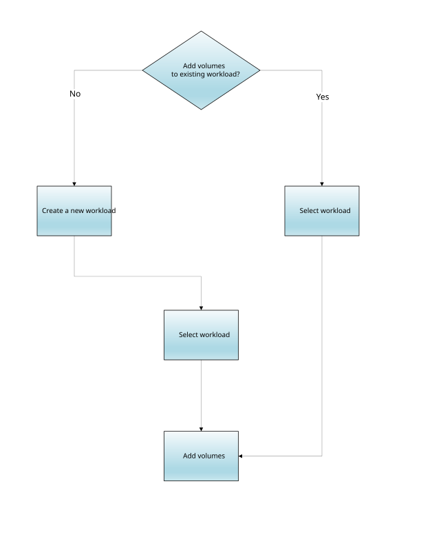

= Fluxo de trabalho de criação de volume no SANtricity System Manager
:allow-uri-read: 
:icons: font
:imagesdir: ../media/

[role="lead"]
No Gerenciador de sistemas do SANtricity, você pode criar volumes seguindo estas etapas.

